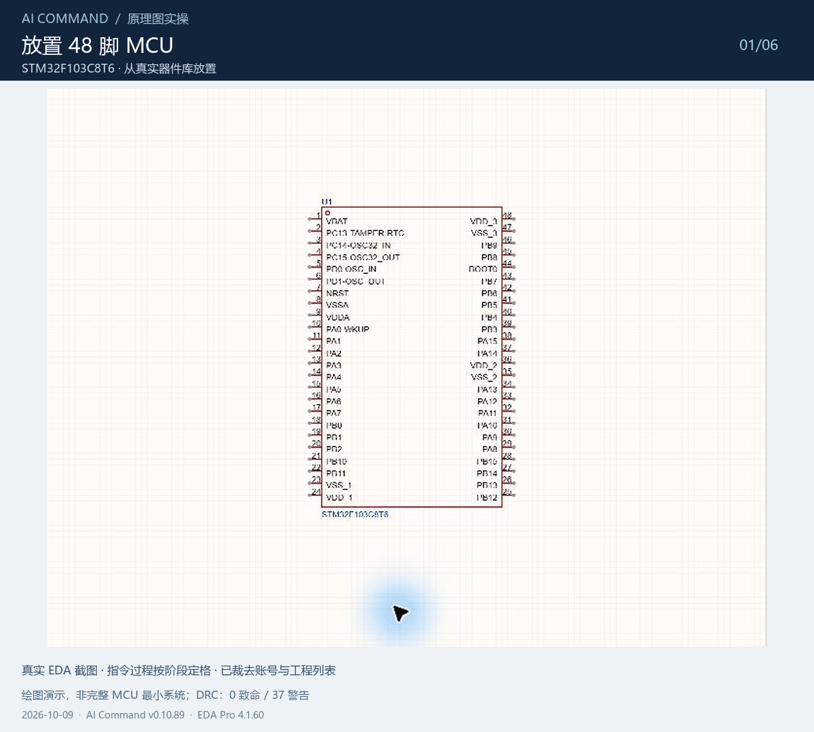
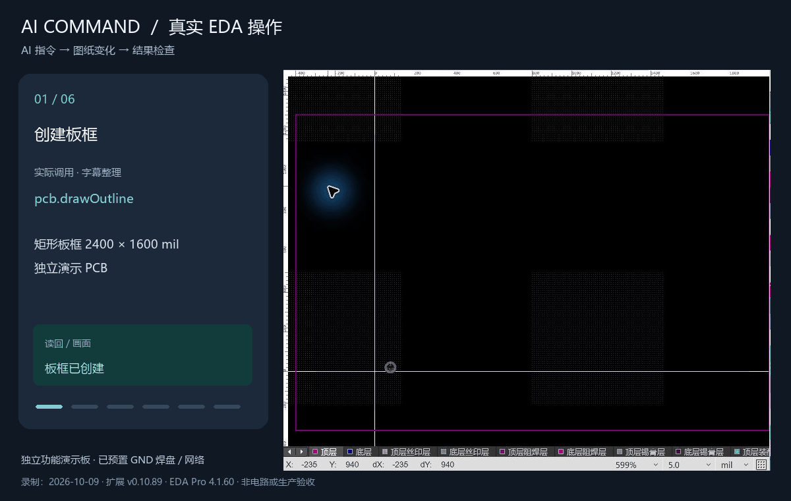

# EasyEDA AI Command Engine

[简体中文](README_ZH.md)

AI Command Engine connects AI tools to JLCEDA Pro through a local Node.js proxy. It provides structured commands for reading and editing schematics, PCB layouts, projects, and component libraries.

## v0.20.128 update (compared with v0.20.127)

The proxy selects an available port in `49720–49729`, reuses a compatible service, and reports its actual endpoint. The extension discovers compatible services and rediscovers after disconnection. Explicit `-Port` / `PORT` selection remains pinned. SMT, PCB backup, and Python helper calls use the discovered endpoint. Binding errors retain system details. The companion skill starts the proxy hidden on Windows without opening the legacy URL, stopping unknown processes, or changing system settings.

The 43 client lifecycle, 19 owner lifecycle, 1 SMT endpoint, 4 PCB grouping, 11 review-bridge, 10 Python helper, 2 skill packaging, 10 binding-error, and 1 real port-conflict checks passed, along with TypeScript and a zero-warning build. Windows host acceptance on JLCEDA Pro 4.1.93 covered automatic discovery/connection at port 49721, the 217-command help listing, read-only project/task queries, and the SMT menu at the actual endpoint. This does not validate all commands, PCB grouping writes, general drawing, save/reopen, whole-board DRC, or production readiness. Linux host behavior is untested.

See the [v0.20.128 GitHub release](https://github.com/quhuii-lgtm/easyeda-aicommand/releases/tag/v0.20.128), [skill v2026.11.08 release](https://github.com/quhuii-lgtm/easyeda-aicommand-skill/releases/tag/v2026.11.08), and [marketplace listing](https://jlc-ext.com/item/eda_gdqnxffl/ai-command-engine) for channel status. Read the [release notes](docs/releases/v0.20.128-en.md) for installation and scope.

## What it does

- Query and edit schematic components, wires, labels, and project pages.
- Inspect and edit PCB components, tracks, vias, copper, supported pads and holes, and silkscreen.
- Run supported differential-pair, length-tuning, pad-branch, silkscreen, and manufacturing checks.
- Export DSN, call an external routing service, and explicitly import SES results.
- Search and maintain component-library resources and inspect project data.

### Feature demos

The following GIFs illustrate feature workflows. They are not evidence that every feature passed v0.20.128 host acceptance.

Available commands depend on the installed extension and EDA version. Query the connected instance's help before using a command. A successful command does not by itself establish saved persistence, electrical correctness, whole-board DRC, or manufacturing acceptance. Auxiliary autorouting does not promise a complete route for every board.

## First installation

The extension, proxy skill, and AI tool are separate parts. Installing `.eext` does not install Node.js or the skill.

1. **Skill and proxy:** download the [v2026.11.08 skill ZIP](https://github.com/quhuii-lgtm/easyeda-aicommand-skill/releases/download/v2026.11.08/ai-command-engine-skill_v2026.11.08_en-zh.zip) from the [skill release](https://github.com/quhuii-lgtm/easyeda-aicommand-skill/releases/tag/v2026.11.08), then install the complete `ai-command-engine/` folder. Keep its references and scripts. Use Node.js >=20.17.0 and run `npm ci --omit=dev` in the skill root.
2. **Background startup:** ask the AI to follow the skill's [connection guide](https://github.com/quhuii-lgtm/easyeda-aicommand-skill/blob/main/ai-command-engine/references/setup.md) and run `scripts/start-proxy.ps1`. Windows starts it hidden and reports the actual endpoint; compatible services are reused.
3. **EDA extension:** get the `.eext` from the [v0.20.128 plugin release](https://github.com/quhuii-lgtm/easyeda-aicommand/releases/tag/v0.20.128), import and enable it, and allow external interaction.
4. **Verify:** use the port reported by the launcher (within `49720–49729`) to check `/health` and `/connections`, confirm the target instance and project, then make a read-only `project.getInfo` call.

See the [first-install guide](docs/QUICKSTART.md). After upgrading, handle and save pending work in every EDA window, then reload each window that still runs the old extension; importing into one window does not update all open windows. Plugin and skill versions are independent. Updating the skill does not overwrite proxy user data or force replacement of a compatible running proxy.

## Project links

- [GitHub releases](https://github.com/quhuii-lgtm/easyeda-aicommand/releases)
- [JLCEDA extension marketplace](https://jlc-ext.com/item/eda_gdqnxffl/ai-command-engine)
- [AI skill releases](https://github.com/quhuii-lgtm/easyeda-aicommand-skill/releases)
- [Issues and feedback](https://github.com/quhuii-lgtm/easyeda-aicommand/issues)
- License: [Apache-2.0](LICENSE)
