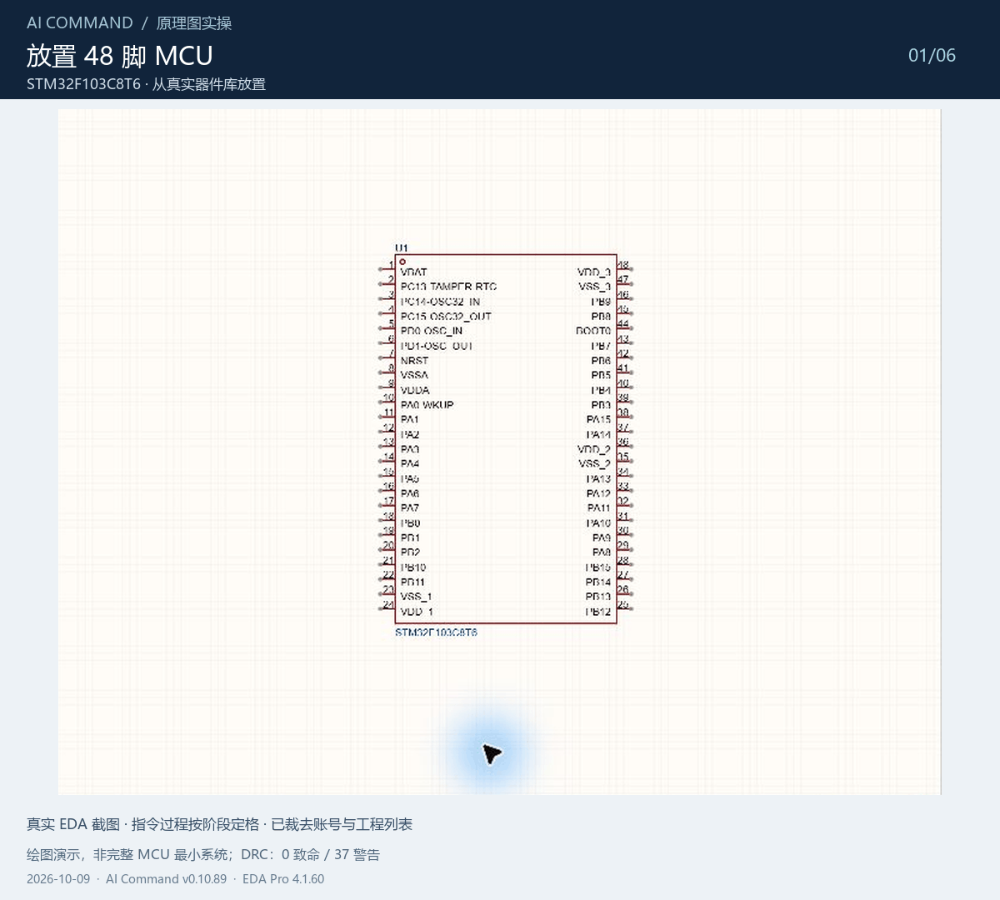
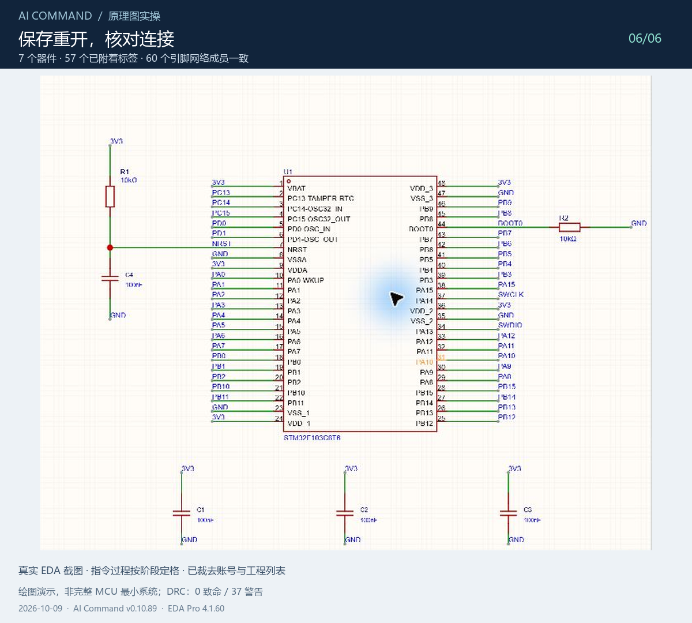
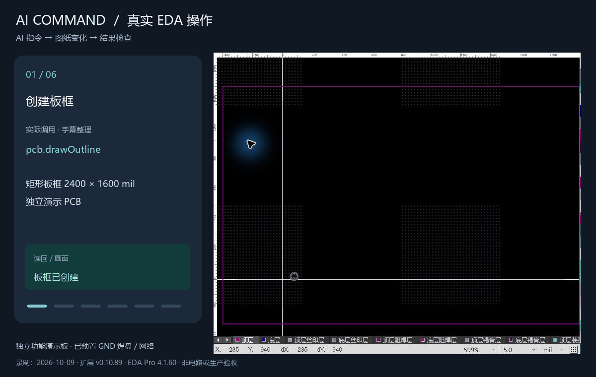
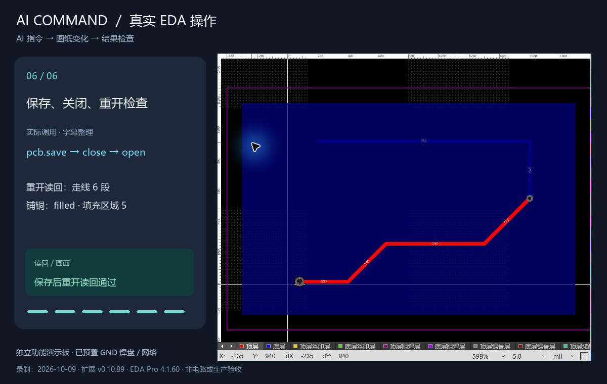

# EasyEDA AI Command

> **AI skill download:** [Skill release v2026.10.28.1](https://github.com/quhuii-lgtm/easyeda-aicommand-skill/releases/tag/v2026.10.28.1) · [Download the complete ZIP](https://github.com/quhuii-lgtm/easyeda-aicommand-skill/releases/download/v2026.10.28.1/ai-command-engine-skill_v2026.10.28.1_en-zh.zip). Extract and install the complete `ai-command-engine/` folder in your AI tool's skills directory. Keep `SKILL.md`, the alternate `SKILL_ZH.md`, `references/`, `scripts/`, and `VERSION`; reload the AI tool and ask it to read `SKILL.md` and confirm the skill version. The skill has its own version and is released separately from the plugin.

**English:** [README.md](README.md) | **简体中文：** [README_ZH.md](README_ZH.md)

EasyEDA AI Command is an AI operation extension for JLCEDA Pro. It works with a local HTTP proxy and a companion AI skill to query and edit schematics, PCBs, projects, and component libraries. Check every result against the project requirements; command success alone does not establish design acceptance.

**First-time setup:** follow the [installation guide](docs/QUICKSTART.md) to install the Node.js proxy, EDA extension, verify a read-only connection, and install the AI skill. These are three separate components. Downloading an `.eext` does not install the proxy or skill.

<a id="first-install-ai"></a>

## First installation: ask your AI to set up and connect

Use an AI coding tool that can access local files and a terminal. Copy the prompt below into it; if you already downloaded the extension or source, provide the local path too.

```text
Help me set up AI Command Engine for JLCEDA Pro for the first time. Work step by step, check the current state before making changes, and report the result and blocker at each step. Do not claim that installation means the EDA connection works.

1. Check local file and terminal access, the operating system, Node.js, and npm. Read package.json and confirm Node.js >=20.17.0.
2. Obtain the complete source repository corresponding to my intended extension version. Read README.md, docs/QUICKSTART.md, package.json, and package-lock.json. Explain where the extension, proxy, and skill come from and whether their versions match; do not guess download URLs.
3. Use a fixed source directory. Preserve existing repositories, skills, personal edits, and credentials. Confirm package.json, package-lock.json, and bridge/command-proxy.mjs are present.
4. Run npm ci in the source directory. Install the complete ai-command-engine/ directory, including references, scripts, and SKILL.md. Do not use the repository-root SKILL.md as the skill entry point.
5. Check http://127.0.0.1:49720/health. If no proxy is running, start node bridge/command-proxy.mjs and keep it available. Identify an occupied port before acting; do not stop an unknown process or change the port.
6. Guide me through importing and enabling the .eext in JLCEDA Pro, allowing external interaction, and opening a trial project. Wait while I complete any sign-in, verification, or manual EDA steps. Do not create or edit a circuit.
7. Guide me to click “AI Command Engine → Start bridge” (“AI 指令引擎 → 启动桥接” in Chinese). Query GET /connections and verify the extension version and project identity. If several instances exist, use the project I specify.
8. Use that instanceId at the top level of POST /command to call project.getInfo. Check JSON ok:true and the project identity. HTTP 200 alone is insufficient. Use version-specific help instead of guessing command parameters.
9. Report Node/npm versions, source directory and revision, skill location, proxy health, EDA/extension versions, instanceId, project identity, and read-only call result. State any missing evidence.

This is a read-only connection check. Do not place parts, route traces, change libraries, configure SMT credentials, or upload files.
```

## v0.20.124 GitHub release

Version v0.20.124 (2026-10-28). Publication status and assets are listed on the [GitHub release page](https://github.com/quhuii-lgtm/easyeda-aicommand/releases/tag/v0.20.124). The source package is `easyeda-aicommand-plugin-source_v0.20.124.zip`; the extension assets are `ai-command-engine_v0.20.124_zh-CN.eext` and `ai-command-engine_v0.20.124_en.eext`. This release contains three source fixes and a retained correction to the legacy `autoRouteStart` help text:

- Task fingerprints preserve array order while still sorting object keys.
- Autoroute terminal states release only the matching job slot. An old slot permits a new start only after one read-only GET confirms the same job ID is explicitly terminal.
- PCB commands consistently use the existing layer-name mapping, including `top`/`bottom`, `t`/`b`, numeric values, and numeric strings. No new layer-count cap or enum preflight was added.

Ten local regression checks, whole-project TypeScript checking, and compilation with the production configuration passed. v0.20.124 has **not** been installed for EDA host acceptance. Existing major-feature acceptance remains based on installed v0.20.123 and applicable earlier records; the final three fixes and help correction are not host-verified. See the [English release notes](docs/releases/v0.20.124-en.md), [Chinese release notes](docs/releases/v0.20.124-zh.md), and [change log](https://github.com/quhuii-lgtm/easyeda-aicommand/blob/main/CHANGELOG.md).

The current public marketplace version is 0.20.51; the v0.20.124 marketplace package is provided for the user to upload and has not yet been submitted for this marketplace review. The [marketplace listing](https://jlc-ext.com/item/eda_gdqnxffl/ai-command-engine) is separate from the GitHub release. The accumulated changes since GitHub v0.20.50 include the accepted major functions summarized in this README and the three local fixes above.

## Main capabilities

- Create and edit schematics and component libraries; organize component properties.
- Create supported independent pads and mounting holes, and inspect silkscreen and manufacturing geometry.
- Check supported differential-pair, length-tuning, and pad-branch routing cases.
- Export DSN, run the external routing service, retrieve SES, and import it explicitly. Auxiliary routing does not guarantee that an entire board will be routed.
- Compare supported routing rules and manufacturing data. Production acceptance still requires the specific board stackup, impedance, order, and other board data.

## Install the three components

1. **Proxy:** use the complete source repository and Node.js >=20.17.0. In its directory, run `npm ci`, then `node bridge/command-proxy.mjs`. Do not substitute a single script for the full proxy source.
2. **EDA extension:** download the matching `.eext` from [GitHub Release v0.20.124](https://github.com/quhuii-lgtm/easyeda-aicommand/releases/tag/v0.20.124), import and enable it in JLCEDA Pro, allow external interaction, then choose “AI Command Engine → Start bridge” (“AI 指令引擎 → 启动桥接” in Chinese). It does not install Node.js, the proxy, or the AI skill.
3. **AI skill:** download the independent [skill release v2026.10.28.1](https://github.com/quhuii-lgtm/easyeda-aicommand-skill/releases/tag/v2026.10.28.1) or [complete skill ZIP](https://github.com/quhuii-lgtm/easyeda-aicommand-skill/releases/download/v2026.10.28.1/ai-command-engine-skill_v2026.10.28.1_en-zh.zip). Install the entire `ai-command-engine/` folder, preserving `SKILL.md`, alternate `SKILL_ZH.md`, `references/`, `scripts/`, and `VERSION`. Reload the AI tool and ask it to read `SKILL.md` and report the version. Skill and plugin version numbers are independent; check the skill's command help against the corresponding plugin functionality. The repository-root `SKILL.md` is navigation only.

Check `/health` and `/connections`, choose the intended project instance, and make a read-only `project.getInfo` request with its top-level `instanceId` before drawing. Follow the [complete setup and troubleshooting guide](docs/QUICKSTART.md).

## Evidence boundaries

- Every `/command` request must specify the intended top-level `instanceId`; document operations should also confirm `params.__docUuid`.
- A write timeout does not mean the write was cancelled. Read the state before deciding what to do next.
- API success, save/readback, close/reopen persistence, DRC, and production acceptance are separate evidence.

Issues: [GitHub Issues](https://github.com/quhuii-lgtm/easyeda-aicommand/issues). License: [Apache-2.0](LICENSE).

## Function demonstrations

The following images and GIFs are included in the extension package. They were recorded on 2026-10-09 with extension v0.10.89 and EDA Pro 4.1.60. They illustrate historical functionality and are not v0.20.124 installation or host-acceptance evidence.

### Schematic: place components, connect labels, save and reopen





The MCU example retained 57 attached net labels and the same net membership for 60 pins after save/reopen. It is a demonstration, not a complete MCU minimum system; the historical DRC reported no fatal items and 37 warnings.

### PCB: outline, tracks, vias and copper pours





The isolated board example retained six track segments and readable fill state after save/reopen. It had pre-existing GND pads and a net; it is not a complete-circuit or manufacturing acceptance result.
