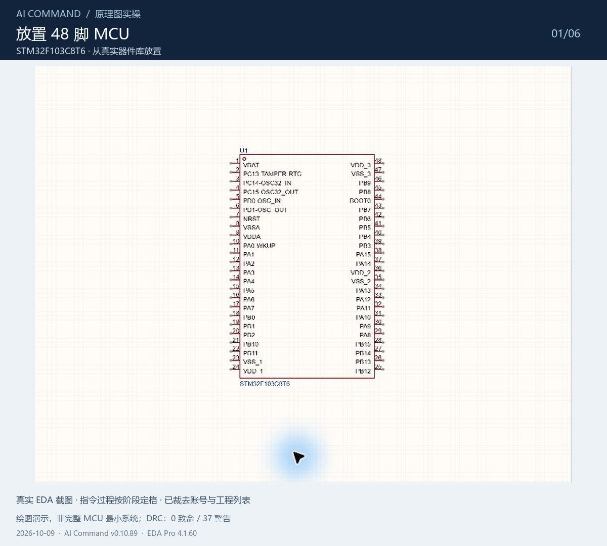
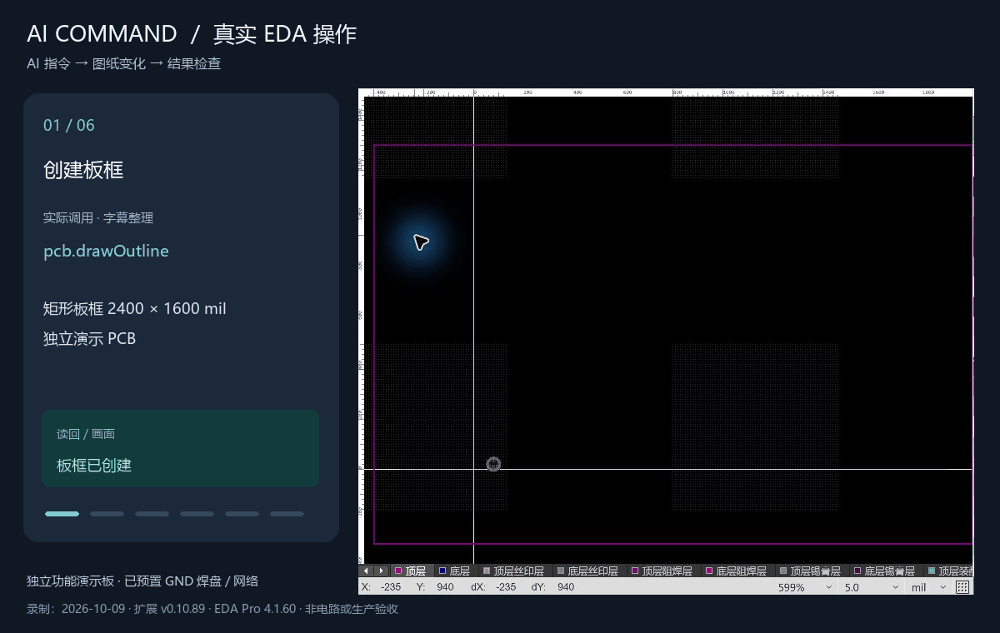

# EasyEDA AI Command Engine

[简体中文](README_ZH.md)

AI Command Engine connects AI tools to JLCEDA Pro through a local Node.js proxy. It provides structured commands for reading and editing schematics, PCB layouts, projects, and component libraries.

## Recent updates and fixes: v0.21.19 (compared with v0.21.18)

### Changes

- **Write timeout and disconnection recovery.** Distinguish not-started, running and unknown outcomes. Unknown outcomes pause subsequent writes to the target window. Read the original request's actual terminal state and the drawing, then acknowledge that request before resuming; do not blindly resend a write.
- **Project and page verification.** Report project opening separately from confirmed active-page identity. Verify the project, document and tab after opening a page rather than treating an unconfirmed page as complete.
- **Schematic wiring and cleanup.** Improve unnamed-branch T-junction readback on named buses, duplicate labels at the same anchor and batch deletion checks. Different anchors and affected branches remain subject to safe refusal rather than forced merging.
- **Library selection and assembly BOM.** Continue checking candidates when the first matching part lacks a footprint. Prefer a verified footprint-bearing device and use the SDK's actual assembly-variant list when selecting and checking exports.
- **Complete companion proxy.** The final skill candidate restores the existing KiRouting service integration, permission checks and original data-directory behavior while retaining the new write-recovery fixes. Use the complete skill; the plugin source repository's generic `bridge/` is not the full KiRouting installation path.

### Actual verification scope

On 2026-11-21, installed v0.21.19 on Windows / JLCEDA Pro 4.1.99 passed independent-project checks for opening projects, page identity and wrong-page refusal, T-junction readback, different-net refusal, restricted zero-write deduplication, two-wire deletion controls, library selection and assembly-BOM comparison. Relevant wires, deduplication and deletion controls passed save/close/reopen checks. In one deduplication scene, the host's first delete returned false without changing the drawing; processing succeeded after saving and reopening. This does not promise automatic recovery from every host refusal.

The final candidate proxy and same-version bridge client also passed real timeout, normal-close and hard-disconnection reconnection, terminal-state readback, original-request acknowledgement, resumed writes and save/reopen checks in foreground independent EDA pages. Both disconnect modes reconnected the same instance. The user's shared running proxy was not restarted.

### Test conditions and upgrade

Two earlier hard-disconnection trials did not actively bring the independent EDA window to the foreground. No reconnect was observed during their respective **27-second and 110-second** observation windows. The cause is unconfirmed. This is not a proven background-timer defect and does not establish a fixed background reconnect deadline.

This round's KiRouting checks cover cold-start protocol, query endpoints and permissions; actual routing was not rerun. Earlier sample and unverified limits still apply. A cross-origin composite FreeRouting simulation error shared by old and new versions remains unassigned, not a claimed fix. Independent-sample acceptance does not establish whole-project or manufacturing acceptance.

**Update the complete companion skill to 2026.11.21.1.** Download the [English/Chinese ZIP](https://github.com/quhuii-lgtm/easyeda-aicommand-skill/releases/tag/v2026.11.21.1), preserve personal settings, install the complete `ai-command-engine/` folder and reload it. Marketplace installation does not install Node.js, proxy dependencies or the skill automatically. Updating files does not replace an already-running old proxy: verify the actual connection and recovery capabilities and follow the complete skill's upgrade guide without forcing a shared proxy restart.

Check the actual [GitHub plugin release](https://github.com/quhuii-lgtm/easyeda-aicommand/releases/tag/v0.21.19) and [marketplace](https://jlc-ext.com/item/eda_gdqnxffl/ai-command-engine). Submission, approval and public availability are separate states.

## What it does

- Query and edit schematic components, wires, labels, and project pages.
- Inspect and edit PCB components, tracks, vias, copper, supported pads and holes, and silkscreen.
- Run supported differential-pair, length-tuning, pad-branch, silkscreen, and manufacturing checks.
- Export DSN, call an external routing service, and explicitly import SES results.
- Search and maintain component-library resources and inspect project data.

### Module reuse

Module reuse adds module extraction, library management, restoration, PCB composition, and component replacement to the AI Command Engine menu and `module.*` command family. Use the matching companion skill's module-reuse guide for the required order; query the target instance's `__help` for parameters. See the companion skill for operation-specific verification scope and conditions.

The selected library directory is remembered. If none is selected, the default is `module-library` under the actual JLCEDA installation directory, not the EDA documents directory. Before using the merged extension, finish any in-flight task in the standalone module-reuse extension and stop its bridge. Existing library files are not moved, overwritten, or automatically migrated.

### Feature demos

The following GIFs illustrate feature workflows. They are not evidence that every feature passed v0.21.19 host acceptance.

Available commands depend on the installed extension and EDA version. Query the connected instance's help before using a command. A successful command does not by itself establish saved persistence, electrical correctness, whole-board DRC, or manufacturing acceptance. Auxiliary autorouting does not promise a complete route for every board.

## First installation

The extension, proxy skill, and AI tool are separate parts. Installing `.eext` does not install Node.js or the skill.

1. **Skill and proxy:** download the [v2026.11.21.1 skill ZIP](https://github.com/quhuii-lgtm/easyeda-aicommand-skill/releases/download/v2026.11.21.1/ai-command-engine-skill_v2026.11.21.1_en-zh.zip) from the [skill release](https://github.com/quhuii-lgtm/easyeda-aicommand-skill/releases/tag/v2026.11.21.1), then install the complete `ai-command-engine/` folder. Keep its references and scripts. Use Node.js >=20.17.0 and run `npm ci --omit=dev` in the skill root.
2. **Background startup:** ask the AI to follow the skill's [connection guide](https://github.com/quhuii-lgtm/easyeda-aicommand-skill/blob/main/ai-command-engine/references/setup.md) and run `scripts/start-proxy.ps1`. Windows starts it hidden and reports the actual endpoint; compatible services are reused.
3. **EDA extension:** get the `.eext` from the [v0.21.19 plugin release](https://github.com/quhuii-lgtm/easyeda-aicommand/releases/tag/v0.21.19), import and enable it, and allow external interaction.
4. **Verify:** use the port reported by the launcher (within `49720–49729`) to check `/health` and `/connections`, confirm the target instance and project, then make a read-only `project.getInfo` call.

See the [first-install guide](docs/QUICKSTART.md). After upgrading, handle and save pending work in every EDA window, then reload each window that still runs the old extension; importing into one window does not update all open windows. Plugin and skill versions are independent. Updating the skill does not overwrite proxy user data or force replacement of a compatible running proxy.

## Project links

- [GitHub releases](https://github.com/quhuii-lgtm/easyeda-aicommand/releases)
- [JLCEDA extension marketplace](https://jlc-ext.com/item/eda_gdqnxffl/ai-command-engine)
- [AI skill releases](https://github.com/quhuii-lgtm/easyeda-aicommand-skill/releases)
- [Issues and feedback](https://github.com/quhuii-lgtm/easyeda-aicommand/issues)
- License: [Apache-2.0](LICENSE)
