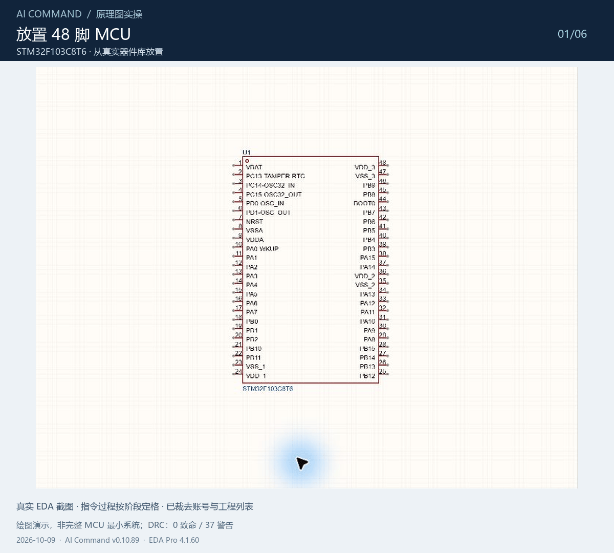
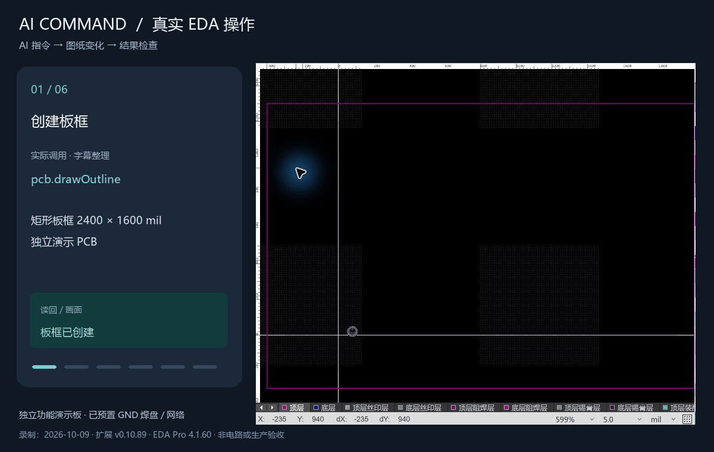

# 嘉立创 EDA AI 指令引擎

[English](README.md)

AI 指令引擎通过本机 Node.js 代理连接嘉立创 EDA 专业版，让 AI 按结构化指令查询和操作原理图、PCB、工程及器件库。

## 本次更新：0.21.2（相比 0.20.136）

模块复用已并入 AI 指令引擎，提供 27 个 module.* 命令，包含提取、模块库管理、恢复、PCB 组合及器件替换接口。本版也包含 0.21.1 中续修的布线任务状态处理。使用前查询目标实例的帮助，并按模块复用指南操作。

用户指定模块目录优先；未指定时，默认使用实际 EDA 安装目录下的 module-library。普通 ACE 功能独立于模块库，原独立模块插件及既有模块数据保留。

Windows / 嘉立创 EDA 专业版 4.1.99 实机验证了空闲代理异常退出后，通过 Reconnect 和后台启动代理恢复同一实例，无需重开 EDA。正常 Stop/Start、工程、PCB 器件、模块库和任务只读查询通过，20 个器件读回前后一致。合并版本此前还验收了提取、自动保存、搜索读回、目录设置，以及恢复后的保存关闭重开。

本地 52 项客户端生命周期、19 项所有者生命周期、模块集成、registry timeout、类型检查和构建通过。本轮没有故意挂起真实宿主在途写入；尚未逐条完成全部 27 条命令的实机验收；代表性 PCB 组合或换件、正式原理图逐脚网名及 DRC/DFM 仍未完成相应验收。

分类标签保留一项样本限制。同一电阻样本在官方 New Project 模式导入至保存重开均保留 DEVICE/SYMBOL/FOOTPRINT 的 META.tags；Existing Project 模式在未开图页、未保存前首次导出已出现资源 UUID 重映射且三处 tags 为空。交给 SDK File 的字节与原归档一致。差异定位至该模式的导入、资源重建和导出往返，SDK 内部具体步骤尚不可确定，本版未加 tags 补丁。

**请同步更新完整的 AI 技能 2026.11.12.5。** 从[技能发布页](https://github.com/quhuii-lgtm/easyeda-aicommand-skill/releases/tag/v2026.11.12.5)下载中英双语 ZIP，保留个人设置，安装完整 ai-command-engine 目录，再重新加载技能。技能代理保留外置用户数据目录适配。

打开 PCB 图页后，「AI 指令引擎」菜单显示 16 项；开始页和原理图页显示 7 项。模块复用使用同一插件、菜单和代理。

各渠道状态见[插件发布页](https://github.com/quhuii-lgtm/easyeda-aicommand/releases/tag/v0.21.2)、[扩展市场](https://jlc-ext.com/item/eda_gdqnxffl/ai-command-engine)和[本次发布说明](docs/releases/v0.21.2-zh.md)。

## 功能

- 查询和编辑原理图器件、导线、标签及工程图页。
- 查看和编辑 PCB 器件、走线、过孔、覆铜、支持的独立焊盘与安装孔，并检查丝印。
- 执行支持范围内的差分、补长、焊盘分支布线及丝印、制造检查。
- 导出 DSN、调用外部布线服务，并显式导入 SES 结果。
- 查询和维护器件库资源，读取工程信息。

### 模块复用

按完整配套技能的模块复用指南和当前实例帮助操作。

### 功能演示

以下 GIF 展示功能流程，不代表 v0.21.2 的每项功能均已通过实机验收。

可用指令取决于已安装插件和 EDA 版本。使用前查询当前连接实例的帮助。指令返回成功本身不能证明工程已保存、电气连接正确、全板 DRC 通过或满足生产要求。辅助自动布线不保证任意整板均可布通。

## 首次安装与连接

插件、代理技能和 AI 工具是三个独立部分。安装 `.eext` 不会自动安装 Node.js 或技能。

1. **技能与代理：**从[技能 v2026.11.12.5 发布页](https://github.com/quhuii-lgtm/easyeda-aicommand-skill/releases/tag/v2026.11.12.5)下载[中英双语 ZIP](https://github.com/quhuii-lgtm/easyeda-aicommand-skill/releases/download/v2026.11.12.5/ai-command-engine-skill_v2026.11.12.5_en-zh.zip)，安装完整 `ai-command-engine/` 并保留参考文件与脚本。使用 Node.js >=20.17.0，首次在技能根目录运行 `npm ci --omit=dev`。
2. **后台启动：**让 AI 阅读技能的[连接说明](https://github.com/quhuii-lgtm/easyeda-aicommand-skill/blob/main/ai-command-engine/references/zh/setup.md)，并运行 `scripts/start-proxy.ps1`。Windows 隐藏启动并返回实际端点；兼容服务会复用。
3. **EDA 扩展：**从[插件 v0.21.2 发布页](https://github.com/quhuii-lgtm/easyeda-aicommand/releases/tag/v0.21.2)取得 `.eext`，导入、启用并允许外部交互。
4. **核对连接：**使用启动器返回的端口（`49720–49729` 范围内）检查 `/health`、`/connections`，核对目标实例和工程，再调用只读 `project.getInfo`。

首次安装步骤详见[GitHub 中文安装指南](https://github.com/quhuii-lgtm/easyeda-aicommand/blob/main/docs/QUICKSTART_ZH.md)。升级前先处理并保存每个 EDA 窗口中的未完成操作，再重新加载仍运行旧版插件的窗口；在一个窗口导入插件不能保证其他已打开窗口也升级。插件与技能版本独立。更新技能不覆盖代理的用户数据，也不强制替换运行中的兼容代理。

## 项目链接

- [GitHub 插件源码与发布包](https://github.com/quhuii-lgtm/easyeda-aicommand)
- [嘉立创 EDA 扩展市场](https://jlc-ext.com/item/eda_gdqnxffl/ai-command-engine)
- [独立 AI 技能仓库与发布](https://github.com/quhuii-lgtm/easyeda-aicommand-skill)
- [反馈与问题](https://github.com/quhuii-lgtm/easyeda-aicommand/issues)
- 许可证：[Apache-2.0](LICENSE)
