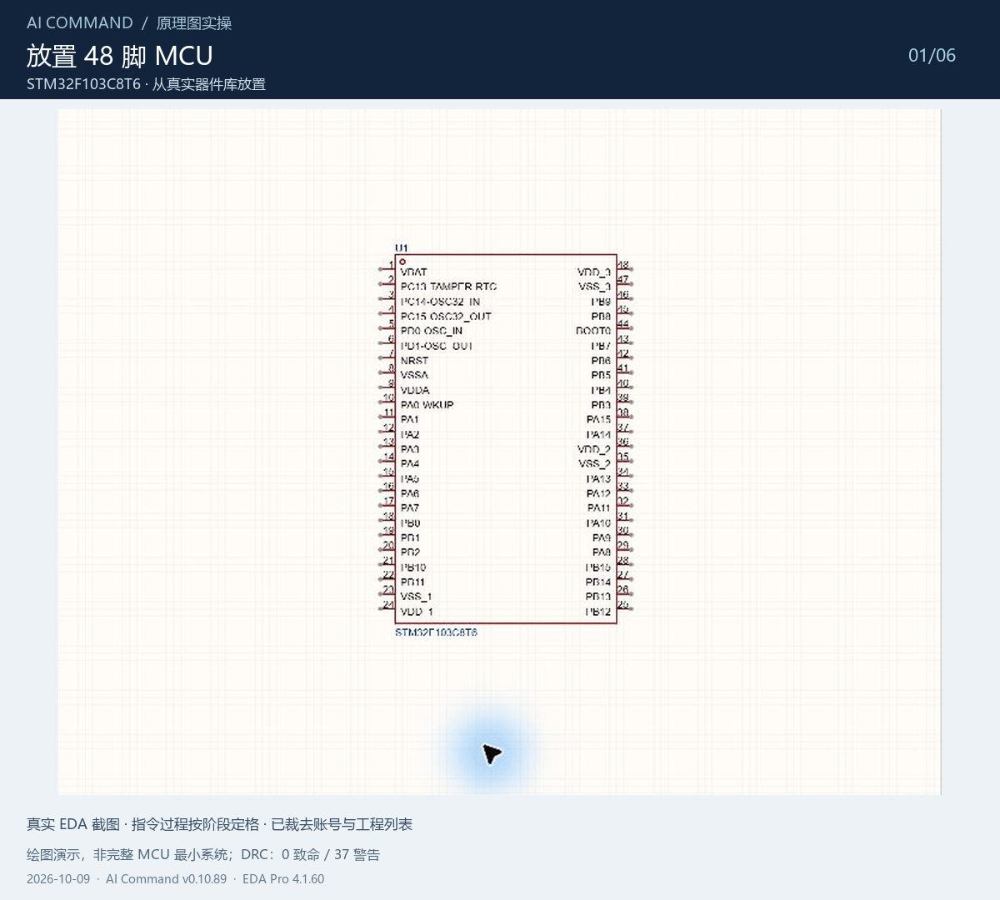
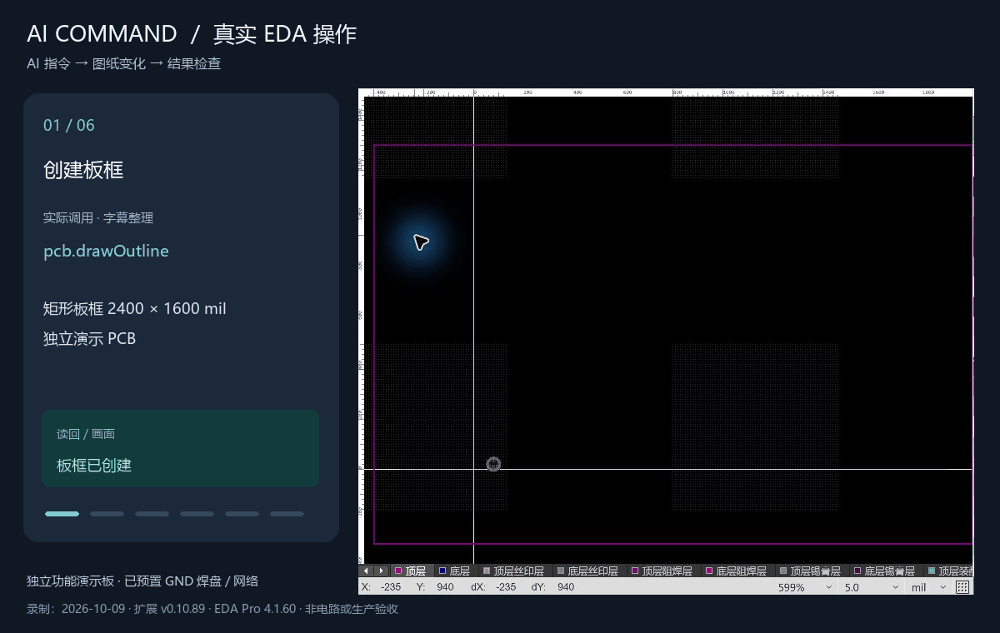

# 嘉立创 EDA AI 指令引擎

[English](README.md)

AI 指令引擎通过本机 Node.js 代理连接嘉立创 EDA 专业版，让 AI 按结构化指令查询和操作原理图、PCB、工程及器件库。

## 最近更新与新功能：0.21.18（相比 0.21.7）

### 本次更新

- **原生自动布线作为默认入口。** FreeRouting、KiRouting 保留为可选工具。先选择目标网络，预览并确认范围；计算或取回结果不等于已导入或已布通。可选引擎的环境按指南另行准备。
- **可选铜路禁布。** 新增 `pcb.planCopperKeepouts` 和 `pcb.applyCopperKeepouts`。AI 根据当前 PCB 实填铜、接点、净距和预览结果决定是否使用、保护哪些铜路，再核对实际生成的禁布区。
- **重铺后的电源地连通保护。** `protectNets` 用于复核重铺后的实际连通；新增断接返回部分完成，并阻止依赖该结果的宏后续步骤。完成布线后仍须检查飞线、DRC 与实铜，不能只看布线结束时的结果。
- **目标与修改核对更完整。** 宏子步骤沿用外层工程、PCB 和页签目标，主动冲突在启动前拒绝。自动排布前核对关联分支；库修改核对实际字段和对象身份；布线菜单仅在确认原任务结束后切换引擎。
- **本版也包含此前的 PCB 能力扩充。** 包括原生布局、装配预检、局部布线与实铜形状检查，以及支持范围内的圆弧、折线、实心填充、挖槽、区域、长度与角度标注、PNG 转矢量、单个测试点及缝合孔操作。具体参数和限制以目标窗口帮助及配套技能为准。

### 0.21.18 安装版实际验证范围

2026-11-20，Windows / 嘉立创 EDA 专业版 4.1.99，独立测试工程中已确认实际运行 0.21.18。宏沿用指定 PCB、冲突零写入通过。中等双层板预览识别两组实铜，错误计划零写入，正确应用新增两处禁布，重复应用复用已有区域；原生布通六个网络，14 段底层线、零新增过孔。重铺及保存、关闭重开后均为零飞线、零 DRC，有效设计源码一致。

独立简单反例板故意让信号直穿实铜：布线结束时零飞线，重铺后 3.3 V 与地网各新增一条飞线。保护正确返回部分完成，宏后续步骤未执行。原工程未写入。本轮原理图、库修改、菜单切换没有重做实际宿主操作；对应修复有定向回归，安装版仅核对入口，不列为本轮实机通过。

### 使用要求与限制

**晶振及其局部分支从所有自动布线引擎排除。** 按已确认的摆放要求安排晶振和两只负载电容，走短直同层线并形成局部接地，按完整技能执行核对。

铜路禁布不是每块板都要套用的固定方案。由 AI 检查当前实填、接点、净距和预览结果后选择。复杂铜面及 CP66 BOOT0 未完成布通属于已测样例的结果，不能据此把某种板型一概禁用。新增断接或结果不明时保留现场，停止依赖步骤，再按读回结果处理。

本次样板结果不保证任意整板都能布通，也不代替制造验收。实铜形状检查不证明全区最窄铜颈或电气孤岛均已覆盖。真正椭圆焊盘、网格填充、半径标注写入、填充与区域的自定义轮廓线宽、批量自动缝合孔和动态原生堆叠表仍有限制。当前默认规则名称的保存语义、图元读取舍入及整工程恢复为合并导入等既有限制继续适用。

**请同步更新完整 AI 技能 2026.11.20.3。** 从[技能发布页](https://github.com/quhuii-lgtm/easyeda-aicommand-skill/releases/tag/v2026.11.20.3)下载[中英双语 ZIP](https://github.com/quhuii-lgtm/easyeda-aicommand-skill/releases/download/v2026.11.20.3/ai-command-engine-skill_v2026.11.20.3_en-zh.zip)，保留个人设置，将完整 `ai-command-engine/` 目录更新到 AI 工具的技能目录，再重新加载。安装市场插件不会自动更新技能或代理依赖；首次安装步骤见下文。

各渠道以[GitHub 插件发布页](https://github.com/quhuii-lgtm/easyeda-aicommand/releases/tag/v0.21.18)与[扩展市场](https://jlc-ext.com/item/eda_gdqnxffl/ai-command-engine)实际状态为准，市场审核与公开上架可能晚于 GitHub。

## 功能

- 查询和编辑原理图器件、导线、标签及工程图页。
- 查看和编辑 PCB 器件、走线、过孔、覆铜、支持的独立焊盘与安装孔，并检查丝印。
- 执行支持范围内的差分、补长、焊盘分支布线及丝印、制造检查。
- 导出 DSN、调用外部布线服务，并显式导入 SES 结果。
- 查询和维护器件库资源，读取工程信息。

### 模块复用

模块复用把模块提取、库管理、文件恢复、PCB组合和器件替换接入 AI 指令引擎菜单及 `module.*` 指令。按配套技能中的模块复用指南顺序操作，参数先查目标实例的 `__help`。具体操作范围与验证条件见配套技能。

选定的模块库目录会被记住。未设置时，默认目录是实际嘉立创 EDA 安装目录下的 `module-library`，不是 EDA 文档目录。改用合并扩展前，先结束独立模块复用扩展中的在途任务并停止旧桥接。现有模块库文件不会被搬动、覆盖或自动迁移。

### 功能演示

以下 GIF 展示功能流程，不代表 v0.21.18 的每项功能均已通过实机验收。

可用指令取决于已安装插件和 EDA 版本。使用前查询当前连接实例的帮助。指令返回成功本身不能证明工程已保存、电气连接正确、全板 DRC 通过或满足生产要求。辅助自动布线不保证任意整板均可布通。

## 首次安装与连接

插件、代理技能和 AI 工具是三个独立部分。安装 `.eext` 不会自动安装 Node.js 或技能。

1. **技能与代理：**从[技能 v2026.11.20.3 发布页](https://github.com/quhuii-lgtm/easyeda-aicommand-skill/releases/tag/v2026.11.20.3)下载[中英双语 ZIP](https://github.com/quhuii-lgtm/easyeda-aicommand-skill/releases/download/v2026.11.20.3/ai-command-engine-skill_v2026.11.20.3_en-zh.zip)，安装完整 `ai-command-engine/` 并保留参考文件与脚本。使用 Node.js >=20.17.0，首次在技能根目录运行 `npm ci --omit=dev`。
2. **后台启动：**让 AI 阅读技能的[连接说明](https://github.com/quhuii-lgtm/easyeda-aicommand-skill/blob/main/ai-command-engine/references/zh/setup.md)，并运行 `scripts/start-proxy.ps1`。Windows 隐藏启动并返回实际端点；兼容服务会复用。
3. **EDA 扩展：**从[插件 v0.21.18 发布页](https://github.com/quhuii-lgtm/easyeda-aicommand/releases/tag/v0.21.18)取得 `.eext`，导入、启用并允许外部交互。
4. **核对连接：**使用启动器返回的端口（`49720–49729` 范围内）检查 `/health`、`/connections`，核对目标实例和工程，再调用只读 `project.getInfo`。

首次安装步骤详见[GitHub 中文安装指南](https://github.com/quhuii-lgtm/easyeda-aicommand/blob/main/docs/QUICKSTART_ZH.md)。升级前先处理并保存每个 EDA 窗口中的未完成操作，再重新加载仍运行旧版插件的窗口；在一个窗口导入插件不能保证其他已打开窗口也升级。插件与技能版本独立。更新技能不覆盖代理的用户数据，也不强制替换运行中的兼容代理。

## 项目链接

- [GitHub 插件源码与发布包](https://github.com/quhuii-lgtm/easyeda-aicommand)
- [嘉立创 EDA 扩展市场](https://jlc-ext.com/item/eda_gdqnxffl/ai-command-engine)
- [独立 AI 技能仓库与发布](https://github.com/quhuii-lgtm/easyeda-aicommand-skill)
- [反馈与问题](https://github.com/quhuii-lgtm/easyeda-aicommand/issues)
- 许可证：[Apache-2.0](LICENSE)
